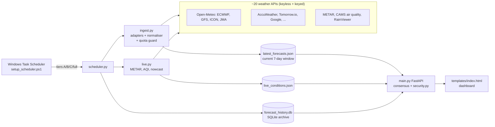

# Weather Consensus: Maharashtra Multi-Provider Forecast Aggregator

Fetches daily forecasts for 7 Maharashtra cities from 20+ weather services and numerical weather prediction (NWP) models, normalises them into one unified schema, and displays them side by side on an interactive dashboard with an **ensemble consensus**: median, interquartile spread, and agreement confidence. It also features an interactive **Google/ECMWF-style meteogram**, a "right now" observation layer (airport METARs, air quality, 2-hour rain verdict, Doppler radar), and on-demand point forecasts for any latitude/longitude in Maharashtra.

> **Active Project Status (November 2026)**
> - **Automated Cloud Ingestion is LIVE**: GitHub Actions runs automatically every 6 hours, archiving timestamped snapshots to the [`data` branch](https://github.com/himesh-mehta/Weather-Forecast-/tree/data).
> - **Live Public Feed (Schema 2.0)**: [latest_maharashtra.json](https://raw.githubusercontent.com/himesh-mehta/Weather-Forecast-/data/latest_maharashtra.json) (updated 4x daily).
> - **Zero-Key Local Demo**: Run `python sync_data.py` to pull the latest GitHub data stream; the dashboard works out of the box with zero API keys required.
> - **32 offline tests pass**: `python -m unittest discover -s tests` (100% passing in ~0.5s).
> - Tested on Windows 11 and Ubuntu (GitHub Actions runner) with Python 3.11 / 3.12 / 3.14.

---

## Contents
1. [Quick start](#1-quick-start)
2. [How it works](#2-how-it-works)
3. [Project layout](#3-project-layout)
4. [Data model](#4-data-model)
5. [Providers and models](#5-providers-and-models)
6. [Fetch cadence and quota guard](#6-fetch-cadence-and-quota-guard)
7. [Consensus rules](#7-consensus-rules)
8. [Data integrity rules](#8-data-integrity-rules-non-negotiable)
9. [HTTP API & public feed](#9-http-api--public-data-feed)
10. [Interactive dashboard & meteogram](#10-interactive-dashboard--meteogram)
11. [Security](#11-security)
12. [Cloud automation & operations runbook](#12-cloud-automation--operations-runbook)
13. [Integration plan for developers](#13-integration-plan-for-developers)
14. [Known issues and caveats](#14-known-issues-and-caveats)
15. [Testing](#15-testing)

---

## 1. Quick start

### Zero-Key Quick Start (Recommended for Testing & Demos)
You do **not** need any API keys to run and inspect the full dashboard. A single command pulls the latest live data collected by the GitHub Actions cloud pipeline:

```bash
cd weather-aggregator
python -m venv .venv && .venv\Scripts\activate      # macOS/Linux: source .venv/bin/activate
pip install -r requirements.txt
python sync_data.py                                # pulls latest multi-model forecasts from the data branch
uvicorn main:app --reload --port 8000              # open http://127.0.0.1:8000
```

### Full Ingestion Mode (With API Keys)
If you want to trigger fresh upstream API calls locally:
1. Copy `.env.example` to `.env`.
2. Fill in your keys (e.g., `WEATHERAPI_KEY`, `OPENWEATHER_KEY`, `ACCUWEATHER_KEY`, `GOOGLE_WEATHER_KEY`, etc.).
3. Set `FETCH_PAUSED=0` in `.env`.
4. Run:
   ```bash
   python scheduler.py                             # full run across all 7 cities + daily archive snapshot
   ```

---

## 2. How it works



- **Adapters** (`fetch_*` in `ingest.py`, one per provider) call an API and return records in the
  **normalised schema** (§4). Each provider walks the cities one after another, so there are no
  request bursts, and every call is checked against the **quota guard** (§6).
- Days are **local IST calendar days** for every provider. Hourly sources are bucketed in local
  time, and `coverage_hours` records how much of the day each one actually saw.
- `latest_forecasts.json` holds only the current window. A refresh replaces a provider's rows only
  if that provider answered; if it failed, its last good rows stay and are tagged with their age in the UI.
- `main.py` computes the consensus **at request time** from the cache, so changing the rules
  needs no re-fetch.

---

## 3. Project layout

| File | What it is |
|---|---|
| `ingest.py` | Provider adapters, normalised schema (`FIELDS`, `make_record`), tiers, quotas, merge into cache, kill switch. CLI: `python ingest.py [cities] [--providers ...] [--tier X]` |
| `http_client.py` | Shared HTTP client for all upstream calls: User-Agent with contact (`CONTACT_URL`), retry with backoff on transient errors, `Retry-After`, 429 handling, jittered pacing |
| `live.py` | "Right now" layer: METAR (aviationweather.gov), air quality (Open-Meteo/CAMS), 2-h rain verdict, RainViewer radar frames |
| `scheduler.py` | Runner used by the scheduled tasks: lock, network wait, logging, archive. `--tier`, `--plan`, `--check`, `--force` |
| `history.py` | SQLite archive: daily snapshots, run log, API usage counter, live observations, sky reports |
| `main.py` | FastAPI app: endpoints, consensus maths, provider display order (`PRIORITY`) |
| `security.py` | Middleware: trusted hosts, rate limits, CSRF-style checks, CSP and security headers, admin auth |
| `templates/index.html` | Single-file dashboard (vanilla JS/CSS; Leaflet is loaded on demand for the radar) |
| `setup_scheduler.ps1` | Installs/removes the 4 Windows scheduled tasks |
| `.github/workflows/weather_ingest.yml` | The same schedule on GitHub Actions (alternative to the PC tasks; see §11) |
| `sync_data.py` | Pulls the forecasts the Actions workflow published (the `data` branch) into a local checkout |
| `export.py` | Builds the public schema-2.0 feed (`latest_maharashtra.json`) and its gzipped timestamped snapshots |
| `run_daily.bat` | Manual one-click run (`scheduler.py` with any args) |
| `tests/test_pipeline.py` | Offline test suite |
| `db_schema.sql` | **Not used.** Draft Postgres schema for a future migration (out of date vs. `history.py`) |
| `.env.example` | Every setting, no secrets |

Generated (git-ignored): `latest_forecasts.json`, `live_conditions.json`, `forecast_history.db`,
`logs/`, `.cache/` (AccuWeather location keys and lock files).

---

## 4. Data model

Every adapter returns records with these fields. **Anything a provider does not supply is
`None`**, shown as "—" on the dashboard.

| Group | Fields |
|---|---|
| Thermal | `temp_min_c`, `temp_max_c`, `feels_like_max_c`, `dew_point_c`, `temp_now_c` (live readings only) |
| Rain | `precip_mm`, `precip_prob_pct`, `precip_hours`, `precip_type` (only if the provider states it) |
| Wind | `wind_speed_kph`, `wind_basis` (`max` / `avg` / `spot` / `now`), `wind_gust_kph`, `wind_dir_deg` |
| Solar | `uv_index`, `sunshine_hours`, `solar_radiation_wm2` (daily mean) |
| Sky | `cloud_cover_pct`, `humidity_pct`, `pressure_hpa` (sea level), `visibility_km` |
| Marine | `wave_height_m`, `swell_height_m`, `sea_surface_temp_c` |
| Astronomy | `sunrise`, `sunset` (local `HH:MM`), `moon_phase`, `moon_illumination_pct` |
| Metadata | `provider`, `model_source`, `city`, `latitude`, `longitude`, `forecast_date` (IST), `coverage_hours`, `flags`, `fetched_at`, `raw_payload` |

**Flags:** `trial` (Windy trial data), `reanalysis` (NASA POWER), `observation` (Weather Union
ground station), `current` (Open-Meteo "now" analysis). All four are kept out of the forecast
consensus.

**SQLite tables (`history.py`):** `daily_forecasts` (one snapshot per 06:00 run, with
`lead_days` and the zlib-compressed raw payload), `ingestion_runs`, `api_usage` (calls per
provider per UTC day), `observations` (15-minute live readings and METARs), `sky_reports`.

---

## 5. Providers

Display order on the dashboard is fixed by `PRIORITY` in `main.py`. Every slot is always shown,
as a row of "—" with a reason when it has no data.

| # | Provider (job name) | Key in `.env` | Tier | Daily guard | Status at handover |
|---|---|---|---|---|---|
| 1 | ECMWF IFS (via `Open-Meteo / ECMWF`) | keyless | C | — | ✅ working |
| 2 | IMD / Mausam | — | — | — | ⛔ no public API, placeholder row only |
| 3 | AccuWeather | `ACCUWEATHER_KEY` | C | 50 | ✅ working (location keys cached in `.cache/`) |
| 4 | The Weather Channel | — | — | — | ⛔ needs a business API key, placeholder row only |
| 5 | Windy | `WINDY_KEY` | C | 500 | ⚠️ trial key returns shuffled data, so it's flagged and excluded |
| 6 | NOAA / GFS (GFS via Open-Meteo) | keyless | C | — | ✅ working |
| 7 | MET Norway | keyless | B | — | ✅ working |
| 8 | NASA POWER | keyless | D | — | ✅ reanalysis, ~3 days behind (past dates only) |
| 9 | OpenWeather (5-day/3-h) | `OPENWEATHER_KEY` | B | 1000 | ✅ working |
| 10 | Tomorrow.io | `TOMORROW_IO_KEY` | B | 500 | ✅ working (also 25/hour limit) |
| 11 | Visual Crossing | `VISUAL_CROSSING_KEY` | B | 1000 records (7 per call) | ✅ working |
| 12 | WeatherAPI.com | `WEATHERAPI_KEY` | B | 30000 | ✅ working |
| 13 | Meteoblue | `METEOBLUE_KEY` | C | 100 | ✅ working |
| 14 | Weatherbit | `WEATHERBIT_KEY` | C | 50 | ✅ working |
| 15 | Meteosource | `METEOSOURCE_KEY` | B | 400 | ✅ working (daily mean wind only) |
| 16 | Stormglass | `STORMGLASS_KEY` | D | 10 | ✅ coastal cities only |
| 17 | "INCOIS" slot = Open-Meteo Marine | keyless | B | — | ✅ coastal cities (real INCOIS not integrated) |
| 18 | DWD Bright Sky (MOSMIX) | keyless | B | — | ✅ only where a MOSMIX station exists (Mumbai, Nagpur) |
| 19 | Met Office DataHub (Global Spot) | `METOFFICE_DATAHUB_KEY` | B | 360 | 🔑 **no key yet**: adapter written, **untested** |
| 20 | Xweather | `XWEATHER_CLIENT_ID` + `_SECRET` | B | 1000 | ✅ working |
| 21 | Weather Union (Zomato, live stations) | `WEATHER_UNION_KEY` | A | 1000 | ✅ Mumbai/Pune/Nashik/Nagpur only |
| 22 | Foreca | `FORECA_KEY` | B | 300 | ✅ working (tested against live API, metric units, 7-day forecast) |
| 23 | Ambee | `AMBEE_KEY` | C | 100 | ✅ working (SI units metric, ~48 h hourly coverage) |
| 24 | Google Weather | `GOOGLE_WEATHER_KEY` | C | 300 | ✅ working (metric 7-day forecast; daily low on next-day cycle) |
| — | Open-Meteo Best Match / ICON / JMA / GEM (Canada) | keyless | C | — | ✅ extra models, listed after the ranked slots |
| — | Open-Meteo Current | keyless | A | — | ✅ "now" analysis (not a measurement) |
| — | Apple WeatherKit | `APPLE_WEATHERKIT_JWT` | C | — | 🔑 no JWT, adapter **untested** |

**Live layer (`live.py`, keyless):** METAR from aviationweather.gov (nearest airport within 60 km:
Mumbai VABB, Nagpur VANP, Sambhajinagar VAAU, Kolhapur VAKP, Nashik VAOZ; **Pune and Ratnagiri
have none**), CAMS air quality via Open-Meteo, a 15-minute nowcast from 5 models, and RainViewer radar.

**Custom lat/lon** (`/api/point`) uses only `CUSTOM_POINT_PROVIDERS` (keyless and generous
quotas); strict-quota services are reserved for the scheduled city runs. The response also includes
`nearest_hub` (the closest of the 7 cities, with its distance) and `in_maharashtra` (inside
`MAHARASHTRA_BBOX`). The dashboard shows these as a link to that city. A point's forecasts are
never replaced by a nearby city's: elevation and the coast make a big difference, e.g. Lonavala vs. Pune.

---

## 6. Fetch cadence and quota guard

| Tier | Scheduled task | When | Providers |
|---|---|---|---|
| A | `WeatherAggregatorLive` | every 15 min | Weather Union, Open-Meteo Current, plus the live layer |
| B | `WeatherAggregatorModels` | every 2 h from 07:00 | WeatherAPI, OpenWeather, Visual Crossing, Tomorrow.io, Meteosource, Xweather, Foreca, Met Office, MET Norway, DWD, Marine |
| C | `WeatherAggregatorEvening` | 18:00 (and inside 06:00) | Open-Meteo multi-model, AccuWeather, Meteoblue, Weatherbit, Windy, Ambee, Google, Apple |
| D | — | 06:00 only | Stormglass, NASA POWER (+ NOAA/ECCC, which return nothing for India) |
| full | `WeatherAggregatorDaily` | 06:00, wakes the PC | everything, plus the **daily archive snapshot** |

- **Quota guard:** `QUOTAS` in `ingest.py` holds `(daily limit, cost per city call)`. Calls are counted in
  `api_usage` per UTC day (most free tiers reset at 00:00 UTC = 05:30 IST); a provider is skipped once
  the next call would pass **90 %**. That covers scheduler runs, custom lookups and manual runs alike.
- **Only the full 06:00 run writes `daily_forecasts`**: one clean snapshot per day, for lead-time and
  accuracy analysis. The full run skips if today's snapshot already exists (`--force` overrides).
- **Fair use (`http_client.py`):**
  - Every request carries `User-Agent: WeatherConsensus/1.0 (+CONTACT_URL)`.
  - Calls to the same provider are spaced 250–450 ms apart.
  - Transient failures (timeouts, 500/502/503/504) are retried at most twice, with exponential
    backoff and jitter, honouring `Retry-After`.
  - On **HTTP 429** the provider is not called again for the rest of that run. Its cities keep their last good data.
- **Deliberately not built: rotating several free accounts/keys to get past a provider's limit.**
  It breaks the providers' terms and gets every key involved banned. If a provider's free tier is
  too small, use a paid plan or ask the provider for a higher limit.
- **When models update:** global models (ECMWF, GFS) run at 00/06/12/18 UTC but become available
  hours later (ECMWF open data ~6–8 h after each cycle, GFS ~3.5–5 h). Polling every 2 hours picks
  each cycle up within about 2 hours of release.
- **Before changing a cadence:** check the provider's real free-tier limit and work out
  `calls/day = runs/day × 7 cities × cost`. Run `python scheduler.py --plan --tier B` to see today's usage.

---

## 7. Consensus rules

Computed in `main.py` (`metric_stats`, `consensus_for`):

- **Median** of the counted values is the headline. Mean, min/max, spread and standard deviation are also reported.
- **Agreement %** is the share of counted values within a tolerance of the median (`METRICS`, e.g. ±1.5 °C for
  temperature, ±5 km/h for wind). Rain is **categorical**: the share agreeing on wet (≥ 0.2 mm) vs. dry.
- **Overall score** is the mean agreement of high temperature, low temperature, rain and wind (each with n ≥ 3).
  80 % and above = high, 60 % and above = fair, below that = low.
- **Excluded from counting, but still shown** (struck through in the UI, with the reason on hover):
  - trial, reanalysis, observation and current flags;
  - partial days (`coverage_hours < 20`) for min/max/rain;
  - wind with `wind_basis` of `avg` or `spot`, for max wind.
- **Outliers** are values more than 2× the tolerance from the median, marked ⚠.
- **Two providers have a different "day" window**, so their daily low is filed under the following date:
  Google (07:00→07:00) and Met Office (night = 18:00→06:00). Their first day has no low ("—").

---

## 8. Data integrity rules (non-negotiable)

These came from the product owner. Keep them when you add providers:

1. **Never predict, interpolate, derive or hard-code a missing value.** If a provider doesn't give it, it's `None` / "—".
   Allowed: unit conversions, and aggregating a provider's *own* finer-grained values (e.g. daily max of its hourly temps).
2. **Never hide a provider row.** Every `PRIORITY` slot is always listed, in that order.
3. **Label non-forecasts:** live readings, model "now" analyses and reanalysis carry flags and stay out of the consensus.
4. **Honest confidence:** agreement scores are real counts of models, never invented percentages.

---

## 9. HTTP API & Public Data Feed

### 9.1 Public Data Stream (Zero-Key / CDN)
For third-party frontends, mobile apps, and external consumers, the GitHub Actions runner publishes pre-computed consensus payloads to the `data` branch every 6 hours:

| Feed | URL | Update Frequency | Description |
|---|---|---|---|
| **Public Feed (Schema 2.0)** | [`latest_maharashtra.json`](https://raw.githubusercontent.com/himesh-mehta/Weather-Forecast-/data/latest_maharashtra.json) | Every 6 hours | Per-city location, daily consensus, and individual provider predictions with reasons (~41 KB gzipped). |
| **Fast Global CDN** | [`jsdelivr CDN`](https://cdn.jsdelivr.net/gh/himesh-mehta/Weather-Forecast-@data/latest_maharashtra.json) | Cached edge | High-availability global edge cache for high-traffic apps. |
| **Live Observations** | [`live_conditions.json`](https://raw.githubusercontent.com/himesh-mehta/Weather-Forecast-/data/live_conditions.json) | Continuous | Real-time METAR reports, AQI, and 2-hour rain nowcast. |
| **Timestamped Archive** | [`history/YYYY/MM/...`](https://github.com/himesh-mehta/Weather-Forecast-/tree/data/history) | 4x daily | Gzipped historical snapshots for longitudinal accuracy tracking. |

### 9.2 FastAPI REST Endpoints (Local or Hosted)

| Method | Path | Purpose |
|---|---|---|
| GET | `/` | Single-page interactive dashboard with Meteogram |
| GET | `/api/locations` | Configured Maharashtra regional hubs and coordinates |
| GET | `/api/today?city=&date=` | Full multi-model consensus, provider table, and deltas for a city |
| GET | `/api/week?city=` | 7-day daily forecast strip (high/low, rain, wind, agreement) |
| GET | `/api/timeseries?city=&metric=` | 7-day multi-model trajectories + ensemble median & spread corridor |
| GET | `/api/consensus?city=&date=` | Statistical summary only (median, mean, spread, standard deviation) |
| GET | `/api/point?lat=&lon=&date=` | On-demand point forecast for any GPS coordinate in Maharashtra |
| GET | `/api/live?city=` or `?lat=&lon=` | METAR airport reports, CAMS air quality, 2-h rain verdict |
| GET | `/api/radar` | RainViewer Doppler radar frames (past ~2 h) |
| GET | `/api/divergence?date=` | Cross-regional agreement comparisons (coastal vs. inland) |
| POST | `/api/report-sky` | Crowdsourced local sky observation (`clear`, `cloudy`, `drizzle`, `heavy`) |
| GET | `/api/history?city=&date=` | Forecast evolution across consecutive lead times |
| GET | `/api/accuracy?city=&field=` | Historical Mean Absolute Error (MAE) per provider |
| GET | `/api/runs` | Automated scheduler run log |
| GET | `/api/usage` | **Admin:** Real-time API call counters vs. provider quotas |

---

## 10. Interactive Dashboard & Meteogram

The dashboard (`templates/index.html`) includes a dual-mode meteorological meteogram powered by Chart.js with Fritsch-Carlson monotone cubic spline interpolation:

1. **Consensus Mode (Google Weather Style)**:
   * Smooth monotonic temperature trajectory in golden amber with a gentle vertical gradient fill.
   * Direct numerical labels rendered directly above each peak (`34.8°`, `34.1°`) for instant legibility.
   * A synchronized 7-day card strip below the chart with weather condition icons and high/low pairs. Clicking any card navigates directly to that day.
   * A subtle, non-intrusive Confidence Spread Ribbon (`[min, max]`) that can be toggled on/off.
2. **All Models Mode (Windy / ECMWF Style)**:
   * Overlays individual model curves (ECMWF, GFS, ICON, GEM, AccuWeather, Google Weather, Foreca, etc.) in a curated meteorological palette.
   * **Interactive Trajectory Isolation**: Hovering over any provider pill highlights its specific forecast in bold (3px stroke) and gently dims other lines (20% opacity), eliminating visual clutter.
   * Dark glassmorphic tooltip with sorted model breakdown and exact delta spreads.

---

## 11. Security

`security.py` is pure Starlette middleware with no extra dependencies:

- **Trusted hosts:** only `127.0.0.1`/`localhost` plus `ALLOWED_HOSTS` are answered. This blocks DNS rebinding.
- **Rate limits per IP:** custom lat/lon lookups 12/min, writes 6/min, other API calls 180/min. Responds 429 with `Retry-After`.
- **POST rules:** must be same-origin (Origin check), `application/json`, and ≤ 4 KB.
- **Headers:**
  - CSP with a per-request nonce on the dashboard script, and `default-src 'none'` on JSON responses;
  - `X-Frame-Options: DENY`, `nosniff`, Permissions-Policy;
  - HSTS when served over HTTPS.
- **Leaflet** is pinned with Subresource Integrity hashes.
- **Admin endpoints** need `X-Admin-Key: $ADMIN_KEY`. If `ADMIN_KEY` is empty, only localhost counts as admin.
- **API docs** (`/docs`) are off unless `ENABLE_API_DOCS=1`. **CORS** is off unless `ALLOWED_ORIGINS` is set.
- **Secrets:**
  - Keys live only in `.env`.
  - `ingest.redact()` strips `key=`, `apikey=`, `token=`, `client_id=` and `client_secret=` from every error message before it is logged or stored.
  - A scan at handover found no key values in any data file, log, database or API response.
  - **Keep it that way:** no keys in code, URLs in logs, or commits.
- **SQL:** every query is parameterised; the f-string SQL only interpolates allow-listed column names.

---

## 12. Operations runbook

### Resuming fetching
1. Set `FETCH_PAUSED=0` in `.env`, then restart `uvicorn`, which reads `.env` at start-up.
2. Optional one-off run: `python scheduler.py` (full run) or `python scheduler.py --tier B`.
3. Re-install the schedule: `powershell -ExecutionPolicy Bypass -File setup_scheduler.ps1`
   (add `-NoLive` to skip the 15-minute task). The tasks run as the logged-in Windows user, and only 06:00 wakes the PC.

### Pausing again
Set `FETCH_PAUSED=1` and restart the server. To stop the schedule, run `setup_scheduler.ps1 -Remove`.
While paused, the scheduler and CLI exit without calling anything. On the dashboard, custom points
return 503 and everything else serves saved data. The radar is deliberately exempt: RainViewer is
keyless and uses no quota.

### Running on GitHub Actions (instead of the PC)

`.github/workflows/weather_ingest.yml` runs the same tiers in the cloud, so no PC has to stay on.
**Use either the Windows tasks or Actions, never both**: they would spend the same quotas twice.

| Schedule (UTC cron) | IST | Tier |
|---|---|---|
| `30 0 * * *` | 06:00 | full: everything + daily archive snapshot |
| `15 1-23/2 * * *` | 06:45, 08:45, … | B: generous-quota APIs |
| `30 12 * * *` | 18:00 | C: strict-quota APIs |
| manual ("Run workflow" button) | any | choose a tier |

The 15-minute live tier (A) is deliberately **not** scheduled on Actions: 96 runs a day is too
many. Live readings and airport reports refresh in the 06:00 run, and the dashboard fetches them
on demand when it has fetching enabled.

**How state survives between runs.** Runners start empty, so the workflow:
- restores `forecast_history.db` (quota counters + archive) and the AccuWeather location keys
  with `actions/cache`. This keeps the quota guard working across runs;
- restores the previous forecasts from the `data` branch, so a provider that fails keeps its last good rows;
- publishes the files to the **`data` branch as a single commit that is force-pushed every run**.
  Archived snapshots are carried forward from the previous commit, so files accumulate but git
  history doesn't.

  Don't commit those files to `main`; they're git-ignored there on purpose.

**What the `data` branch contains** (public if the repo is public):

| File | What it is |
|---|---|
| `latest_maharashtra.json` | **Public feed, schema 2.0** (`export.py`). Contains `meta` (generated time in UTC and IST, data update time, units, bounding box) plus, per city: location (lat/lon, region, coastal, elevation), `daily_consensus` (median / min / max / models counted / agreement per field), and `provider_forecasts` (each provider's own daily values, its fetch time, and why any value wasn't counted). About 340 KB. |
| `history/YYYY/MM/<UTC time>.json.gz` | Gzipped snapshot of that feed, **at most one per 6-hour UTC block**: ~41 KB each, ~4 a day, ~60 MB a year |
| `latest_forecasts.json` | Internal cache with raw provider payloads (used by `sync_data.py` and the dashboard) |
| `live_conditions.json` | Airport METARs, air quality and the 2-hour rain verdict |

- **Direct URL:** `https://raw.githubusercontent.com/himesh-mehta/Weather-Forecast-/data/latest_maharashtra.json`
- **jsDelivr** (`https://cdn.jsdelivr.net/gh/himesh-mehta/Weather-Forecast-@data/latest_maharashtra.json`) also works, but caches branch files for hours. Use the raw URL when freshness matters.
- **No model-cycle field.** Upstream APIs don't say which model run (00z/06z/…) they served, so the feed gives each provider's actual fetch time instead of a guessed cycle.
- **Long term:** once the archive passes a few hundred MB, move old years to a GitHub Release asset so each run's clone stays fast.

**One-time setup:**
1. Make `weather-aggregator/` the **root** of its own GitHub repository. The workflow must sit at
   `<repo root>/.github/workflows/`. (If you keep it inside a bigger repo instead, move the file to
   that repo's root and add `defaults: run: working-directory: weather-aggregator`, plus the same
   prefix on every `path:`.)
2. **Settings → Secrets and variables → Actions → Secrets:** add the keys you have. Names
   are exactly as in `.env.example`:
   - `WEATHERAPI_KEY`, `OPENWEATHER_KEY`, `VISUAL_CROSSING_KEY`, `TOMORROW_IO_KEY`, `WEATHERBIT_KEY`, `METEOSOURCE_KEY`
   - `ACCUWEATHER_KEY`, `METEOBLUE_KEY`, `WINDY_KEY`, `STORMGLASS_KEY`, `AMBEE_KEY`, `GOOGLE_WEATHER_KEY`
   - `APPLE_WEATHERKIT_JWT`, `METOFFICE_DATAHUB_KEY`, `XWEATHER_CLIENT_ID`, `XWEATHER_CLIENT_SECRET`, `WEATHER_UNION_KEY`, `FORECA_KEY`

   A missing secret just means that provider is skipped. Quickest way: install the GitHub CLI
   (`winget install --id GitHub.cli`, then `gh auth login`) and run
   `powershell -ExecutionPolicy Bypass -File tools\set_github_secrets.ps1`. It uploads exactly
   these keys from your local `.env` and prints only their names. Don't upload the whole `.env`:
   it contains settings and a database URL that aren't needed.
3. **Optional, under the Variables tab:** `FETCH_PAUSED=1` pauses every run without touching code.
   `WINDY_TRIAL=0` is only for a paid Windy key.
4. The workflow requests `contents: write` itself. If the push to `data` fails with 403, set
   **Settings → Actions → General → Workflow permissions** to "Read and write permissions".
5. **Actions tab → Weather ingestion → Run workflow** (tier `full`) to test. Logs are attached to
   each run as an artifact.

**To use the data locally:** run `python sync_data.py` (or `--every 15`) in a checkout of the repo.
It downloads the latest published files without staging anything, and the dashboard picks them up
automatically.

**Good to know:**
- GitHub **disables scheduled workflows after 60 days without repository activity**. Re-enable
  them from the Actions tab, or push a commit.
- Cron runs can start several minutes late.
- About 15 runs a day at roughly 1–2 minutes each: free on public repos, and within the
  2,000 free minutes a month on private ones.
- In a **public** repo, logs and the `data` branch are public. They contain no keys:
  `ingest.redact()` scrubs error messages, and GitHub masks secret values in logs.

### Useful commands
```bash
python scheduler.py --plan --tier C          # what a tier would call + today's quota use (no calls)
python scheduler.py --check                  # network + which keys are present (no calls)
python ingest.py --providers "Google Weather" Ambee   # refresh only some providers (others untouched)
python ingest.py Mumbai Pune                 # refresh only some cities
python -m unittest discover -s tests -v      # tests
```

### Logs
`logs/ingestion_YYYY-MM-DD.log` (tiers B/C/full), `logs/live_YYYY-MM-DD.log` (tier A), and
`logs/last_run.json`. Logs older than 30 days are deleted automatically.

### Troubleshooting
| Symptom | Likely cause |
|---|---|
| A provider row shows "data from N h ago" | Its last fetch failed or the quota guard held it back. Check the log and `/api/usage`. |
| "held back by the daily quota guard" | 90 % of today's quota is used. It resets at 05:30 IST. |
| Open-Meteo 503 for a city now and then | Upstream hiccup. The next run retries and the last good data stays. |
| Dashboard says "Automatic updates may not have run" | The PC was off/asleep, the tasks aren't installed, or `FETCH_PAUSED=1`. |
| `Host not allowed` (400) | You opened the server through a name not in `ALLOWED_HOSTS` (e.g. LAN IP). |

---

## 13. Integration plan for developers

### 12.1 Checklist: adding a new provider

1. **Probe it first** with a throwaway script. Confirm:
   - **units:** look for a `units=metric`/`si` option rather than converting;
   - **time zone and day boundaries:** is a "day" midnight→midnight IST, UTC, or something like 07:00→07:00?
   - **hourly vs. daily:** some "daily" endpoints actually return hourly data (Ambee does);
   - **coverage for all 7 cities;**
   - **the real free-tier limit;**
   - **error format,** and whether the key goes in a header or the URL.
2. **Add the key** to `.env` and `.env.example` (empty value). If the key goes in the URL under a
   new parameter name, extend `_SECRET_RE` in `ingest.py` so it gets redacted.
3. **Write the adapter** in `ingest.py`:
   ```python
   async def fetch_newprov(client: httpx.AsyncClient, loc: dict, key: str) -> list[dict]:
       resp = await client.get("https://api.newprov.example/v1/daily",
                               params={"lat": loc["lat"], "lon": loc["lon"], "units": "metric"},
                               headers={"Authorization": f"Bearer {key}"})
       resp.raise_for_status()
       return [make_record("NewProv", "NewProv Daily", loc, d["date"], raw_payload=d, coverage_hours=24,
                           temp_min_c=d.get("tmin"), temp_max_c=d.get("tmax"),
                           precip_mm=d.get("rain_mm"), wind_speed_kph=d.get("wind_max_kmh"))
               for d in resp.json().get("days", [])]
   ```
   - Map only fields the provider really gives (§8). For hourly sources, use `HourlyBuckets` + `coverage()`.
   - Set `wind_basis="avg"` if it only gives a mean wind, and flag non-forecasts (`flags=["observation"]`).
   - Return `[]` for "location not supported", so the dashboard shows "not available for this location"
     instead of an error.
4. **Register it in three places:**
   - `TIER2` (name, env var or a tuple of env vars, adapter);
   - `TIERS` (pick a cadence that fits its quota);
   - `QUOTAS` (daily limit and cost per city call). **Never ship a keyed provider without a quota entry.**
5. **Optionally:**
   - add it to `CUSTOM_POINT_PROVIDERS` if its quota is generous;
   - add it to `JOB_LABELS` if its records use a provider name different from the job name.
6. **Display:** add a slot to `PRIORITY` in `main.py`, or leave it out and it appears unnumbered after the ranked slots.
7. **Verify** before running the whole schedule:
   - `python ingest.py --providers "NewProv"` (fetches only that provider; nothing else is touched);
   - check each field against the provider's own website for one city;
   - check the dashboard row and the consensus exclusions;
   - add a test for any parsing quirk.

### 12.2 Integration backlog (prioritised)

| Priority | Item | Why / notes |
|---|---|---|
| P0 | **Add `Foreca` to `QUOTAS`**, then verify its auth flow and field mapping | It currently has no quota guard. Foreca tokens usually come from a login endpoint and expire, so a static `FORECA_KEY` may stop working. It only maps 5 fields. |
| P0 | **Met Office key**: put it in `METOFFICE_DATAHUB_KEY` and run `--providers "Met Office"` | Adapter untested. Confirm the night-minimum → next-day mapping against real data. |
| P1 | **Weather Union wind unit** | The adapter assumes m/s; confirm against the docs or a windy day. |
| P1 | **CPCB air quality** (data.gov.in key) | The current AQI is a CAMS model estimate, not station data. |
| P1 | **Accuracy scoring UI** | `/api/accuracy` fills in after ~4 days of 06:00 snapshots. Add a dashboard view. Consider METAR / Weather Union observations as ground truth too (the `observations` table). |
| P2 | **IMD**, The Weather Channel, Apple WeatherKit | IMD: no public API (would need scraping or a partnership). TWC: business key. Apple: needs an ES256 JWT signing step. |
| P2 | **Real INCOIS** marine data | Slot 17 currently uses Open-Meteo Marine. |
| P2 | Skip Weather Union for its 3 unsupported cities | Halves its calls (~670 → ~380/day). |

### 12.3 Platform roadmap

1. **Postgres migration:** port `history.py` (schema in code is the source of truth; `db_schema.sql` is stale), and move
   the cache from JSON files to tables. Needed before running more than one server process.
2. **Deployment:**
   - Linux VM with systemd timers or cron instead of Windows Task Scheduler (the same `scheduler.py --tier X` commands);
   - Caddy, Nginx or Cloudflare in front for HTTPS; then set `TRUST_PROXY=1`, `ALLOWED_HOSTS`, and a strong `ADMIN_KEY`.
3. **Partner API keys:** `X-API-Key` checked against SHA-256 hashes in the database, with per-key rate limits
   (extend `RATE_RULES` in `security.py`).
4. **CI:** run the test suite on every push; add a lint step (ruff).
5. **Rate limiter and caches are in-memory, per process.** Move them to Redis when you run more than one instance.

---

## 14. Known issues and caveats

- **Windy:** the trial key returns shuffled data. It's flagged and excluded; set `WINDY_TRIAL=0` only with a paid key.
- **Pune and Ratnagiri:** no airport METAR within 60 km (Pune's VAPO is an Air Force field and isn't in the public feed).
- **RainViewer free tier:** past ~2 h only, zoom ≤ 7, no satellite layer. Thin streaks on dry days are ground clutter.
  The base map is OpenStreetMap (CARTO's tiles now need a key).
- **Custom points far from an airport:** the METAR card warns when the place and the airport differ by more than 250 m in elevation.
- **Quota counter on 13 Nov 2026** was pre-seeded with *estimates* of calls made before the counter existed.
- **Open-Meteo** occasionally returns 503; it's handled with retry on the next run and last-good data.
- **Scheduler is Windows-only** (`setup_scheduler.ps1`); the Python side is cross-platform.
- **Sky reports** are stored locally and rate-limited per client. There are no user accounts.

---

## 15. Testing

```bash
python -m unittest discover -s tests -v     # 32 tests, ~0.5 s, no network, no writes to the real DB
```

The suite covers parsing helpers, secret redaction, the normalised record, consensus and exclusion
rules, the always-listed provider order, the quota guard, the SQLite archive, the kill switch,
input validation, the security layer, admin auth, the export schema 2.0 serializer, and
nearest-hub geospatial distance calculations. It forces `FETCH_PAUSED=1`, so it can never
spend API quota. `pytest` also runs it unchanged.
